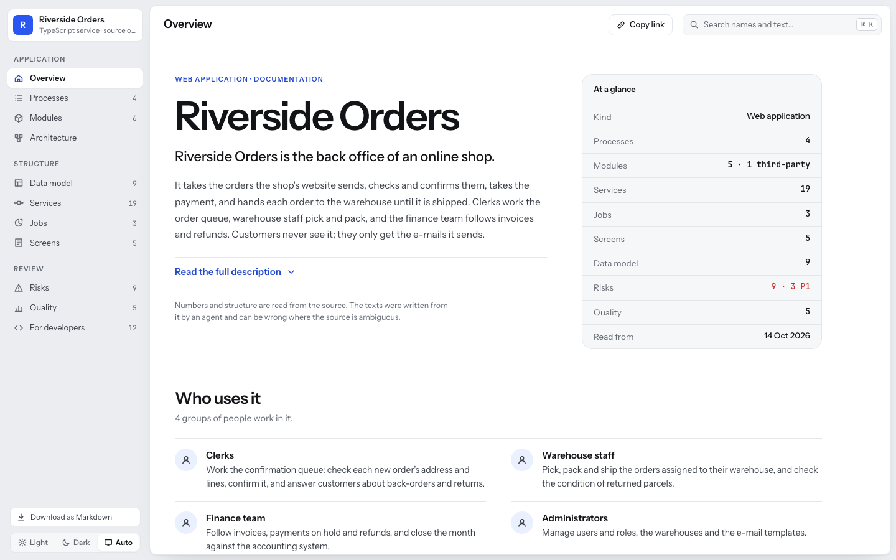
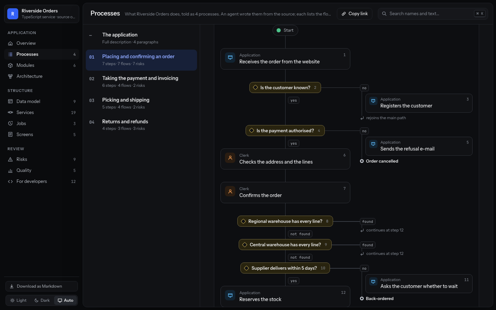
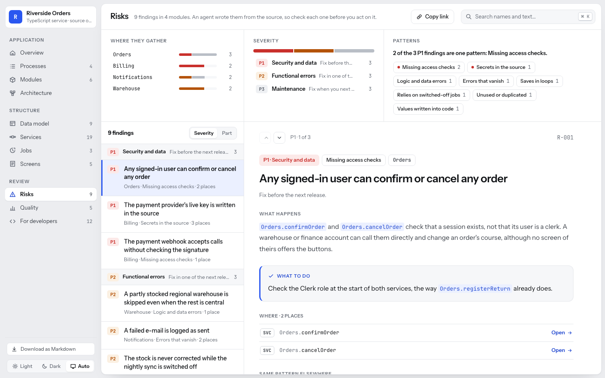
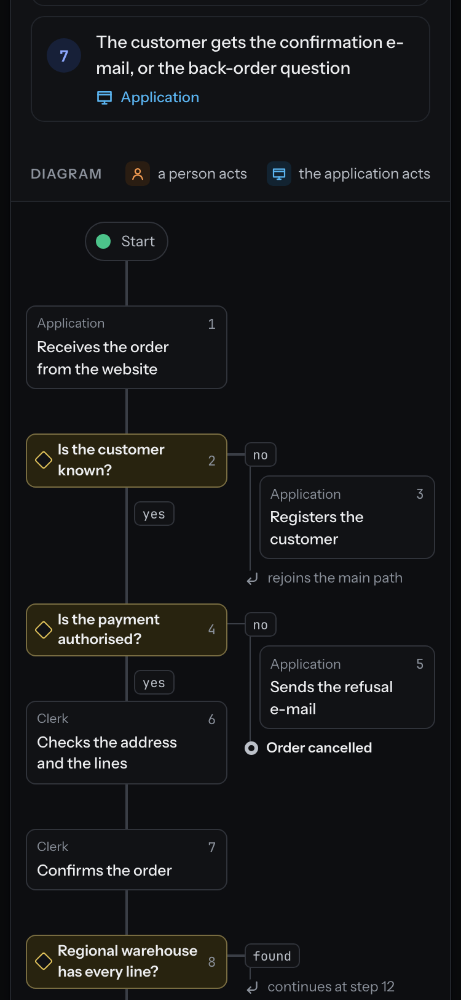

# The report kit

Everything needed to turn an analysis of an application into the report this
skill describes: one HTML file that opens offline, with a sidebar menu,
Overview, Processes with their diagrams, Modules, Architecture, Data model,
flows, Screens, Risks, Quality and For developers, in light and dark, at phone
width and on paper. No dependencies, no build tool, no network.

**Start here; never rebuild the components from scratch.** Write the data JSON
from your analysis and run `build.js`. To change the look, change
`tokens.css` only.



| File | What it is |
|---|---|
| `tokens.css` | The design tokens: colours by role for light and dark, kind colours, P1/P2/P3, spacing and type scales, radii, shadows, the two fonts. The only file to edit to restyle. |
| `report.css` | The components, all prefixed `r-`: shell, sidebar, header, search, theme switch, sections, the two prose layers, provenance, badges, rows, tables, filters, the drawings, every page, narrow screens, print, reduced motion. Reads only tokens. |
| `icons.svg` | One sprite of 16-unit, 1.5-stroke, round-cap icons, drawn for this kit: menu entries, controls, people, systems, stores, queues, schedules, and one per step kind in a drawing. |
| `report.js` | The renderer. `Report.mount(data, element)` draws the whole report from the data; `Report.markdown(data)` writes the same content as Markdown. Sets text with `textContent` only, never markup. |
| `build.js` | `node build.js data.json out.html [--title X] [--lang en\|pl\|de] [--md out.md]` — inlines tokens, fonts, styles, icons, renderer and data into one file. |
| `example-data.json` | A complete example: *Riverside Orders*, an invented web-shop back office. |
| `template.html` | `node build.js example-data.json template.html` — the example built. Open it to see every page. |
| `fonts/` | Instrument Sans and JetBrains Mono (woff2) with their licence texts. |
| `screenshots/` | The example, light and dark, wide and at phone width. |

## How an agent uses it

1. Analyse the application (with whatever tool fits its technology) and write
   the texts the skill asks for: summaries, process traces, risks, notes.
2. Write one JSON file in the shape below. Leave out what you do not have: a
   page whose data is missing does not appear in the menu.
3. `node assets/build.js report-data.json Report.html` (add `--md Report.md`
   for the Markdown copy, `--lang pl` for Polish labels).
4. Open the file, look at every page in both themes and at phone width, and
   run `reference/checklist.md` over it.

Copying `template.html` and replacing the JSON inside its
`<script type="application/json" id="report-data">` block works too — the
block must stay valid JSON with every `<` written as `<`. `build.js`
does that escaping for you, so prefer it.

## The data

```json
{
  "lang": "en",
  "app": {
    "name": "Riverside Orders",
    "kind": "Web application",
    "source": "TypeScript service · source of 14 Oct 2026",
    "readAt": "2026-10-14",
    "summary": "Two to four sentences. The first becomes the Overview's lead.",
    "story": "The full description. Paragraphs separated by a blank line.",
    "audience": [{ "who": "Clerks", "what": "Work the confirmation queue…" }]
  },
  "provenance": { "by": "an agent", "written": "2026-10-14" },
  "layout": { "fullDescription": "fold" },
  "terms": {
    "parts":   { "label": "Modules",    "one": "module", "other": "modules" },
    "records": { "label": "Data model", "one": "table",  "other": "tables" },
    "screens": { "label": "Screens",    "one": "screen", "other": "screens" }
  },
  "flowKinds": [
    { "key": "svc", "tag": "SVC", "label": "Services", "one": "service", "other": "services" },
    { "key": "job", "tag": "JOB", "label": "Jobs",     "one": "job",     "other": "jobs" }
  ],
  "processes": [{
    "name": "Placing and confirming an order",
    "summary": "One to three sentences.",
    "story": "One paragraph per stage of the traced case.",
    "steps": [{ "text": "A clerk confirms the order", "who": "person", "role": "Clerk" },
              { "text": "The application reserves the stock", "who": "app" }],
    "flows": ["Orders.confirmOrder", "Warehouse.reserveStock"],
    "diagram": [ "… items, see below; only when the process branches …" ]
  }],
  "parts": [{
    "name": "Orders", "thirdParty": false,
    "summary": "…", "story": "…",
    "notes": [{ "title": "Statuses", "table": { "columns": ["Status", "Set by"], "rows": [["Confirmed", "Orders.confirmOrder"]] } },
              { "title": "Layout", "items": ["…"] }, { "title": "…", "text": "…" }],
    "dependsOn": [{ "name": "Billing", "count": 3 }],
    "runs": [{ "kind": "job", "name": "Orders.expireUnpaidOrders", "schedule": "daily at 02:00", "on": true },
             { "kind": "endpoint", "name": "POST /orders" }]
  }],
  "flows": [{
    "name": "Orders.submitOrder", "kind": "svc", "summary": "…",
    "params": [{ "name": "order", "type": "OrderRequest" }], "returns": "Order",
    "from": ["POST /orders (website)"], "roles": ["website client"],
    "calls": ["Customers.findCustomer"], "steps": 14,
    "drawing": [ "… items, see below …" ]
  }],
  "screens": [{ "name": "Orders.OrderList", "summary": "…", "roles": ["Clerk"],
                "openedFrom": ["main menu"], "starts": ["Orders.cancelOrder"], "shows": ["Orders.Order"] }],
  "dataModel": [{ "name": "Orders.Order", "summary": "…",
                  "fields": [{ "name": "status", "type": "OrderStatus" }],
                  "relations": [{ "to": "Customers.Customer", "many": "*-1" }],
                  "access": [{ "role": "Clerk", "read": true, "write": true }] }],
  "architecture": {
    "context":    { "nodes": [{ "id": "app", "name": "Riverside Orders", "kind": "app" },
                              { "id": "shop", "name": "Shop website", "note": "REST", "kind": "system", "group": "Systems that send data" }],
                    "links": [{ "from": "shop", "to": "app", "label": "orders" }] },
    "containers": { "nodes": [{ "id": "api", "name": "REST API", "kind": "part" },
                              { "id": "db", "name": "Database", "kind": "store" }],
                    "links": [{ "from": "api", "to": "db", "label": "writes" }] },
    "access": [{ "role": "Clerk", "parts": { "Orders": "read, write" } }],
    "open": ["Where the application is hosted cannot be told from the source."]
  },
  "themes": { "access": { "name": "Missing access checks", "text": "One sentence." } },
  "risks": [{ "id": "R-001", "level": "P1", "theme": "access", "title": "What is wrong, specific",
              "detail": "Consequence first, then mechanism.", "where": ["Orders.confirmOrder"],
              "fix": "One sentence, an action." }],
  "quality": [{ "id": "unused", "group": "Unused", "warn": true, "count": 1, "total": 23,
                "label": "Services nothing reaches", "sub": "No caller, no screen, no job",
                "explain": "What the count means and what it does not.",
                "rule": { "quote": "The published rule, quoted.", "source": "Where it is published" },
                "items": { "columns": ["Service", "Lines"], "rows": [["Notifications.legacyDigest", "22"]] } }],
  "forDevelopers": {
    "where": [{ "topic": "Where an order's status changes", "place": "Only in `Orders.changeStatus`…" }],
    "conventions": [{ "pattern": "find…", "meaning": "Reads only.", "count": 2 }],
    "pitfalls": ["Changing a status outside `Orders.changeStatus` skips the history."]
  }
}
```

Rules the renderer relies on:

- **Every field is optional except `app.name`.** A page exists only when it has
  content; the Overview always does. A risk needs `level` (`P1`–`P3`) and
  `title`, or it is dropped.
- **Names are qualified** (`Part.Name`) and identical everywhere: in `flows`,
  `where`, `calls`, `shows`. The part is the longest `parts[].name` the name
  starts with; it is shown muted. A name the report has a page for becomes a
  link wherever it appears in a list.
- **Names inside prose go between backticks** — `` `Orders.submitOrder` `` —
  and become code-font links when the report has them (a risk id like
  `` `R-005` `` too). Prose has no other markup: paragraphs are separated by a
  blank line.
- **Technology words come from the data**: `terms` names the parts, records
  and screens and their counted nouns; `flowKinds` makes one menu entry per
  kind of flow, each with its kind tag. With no `flowKinds` there is one
  entry, *Flows*.
- `layout.fullDescription`: `"fold"` (default) opens the application's full
  description in place on the Overview; `"page"` makes the Overview's button
  open it as Processes, item 0. Pick one per report.
- `dependsOn` feeds the module page's Connections and the Architecture
  dependency matrix; *used by* is worked out from it.

### Diagram and drawing items

A process `diagram` and a flow `drawing` use the same items and are drawn the
same way: top to bottom, the main path straight down, every other way out of a
decision to the right.

```jsonc
{ "step": "Confirms the order", "who": "Clerk", "by": "person" }          // a process step (by: person | app)
{ "step": "Reads the payment", "kind": "read", "value": "of the order" }  // a flow step
{ "decision": "Regional warehouse has every line?", "ways": [
    { "label": "found", "join": "Reserves the stock" },                  // goes on at that step further on
    { "label": "not found" } ] }                                          // neither end nor join: the main path
{ "decision": "Is the payment authorised?", "ways": [
    { "label": "no", "then": [ { "step": "Sends the refusal e-mail", "by": "app" } ], "end": "Order cancelled" },
    { "label": "yes" } ] }
{ "loop": "For each line in the request", "body": [ … ] }
{ "end": "Returns the order", "returns": "Order" }
```

Step kinds (each with its colour and icon): `read`, `change`, `save`,
`delete`, `call`, `show`, `message`, `var`. Rules tried in turn are a chain of
decisions whose "found" way `join`s the step they all lead to. Which way
stays on the main path: one that does not end before one that does, then the
shorter one.

## Restyling

Change `tokens.css`, nothing else: colours per role and theme, the accent,
the kind colours, the type and spacing scales, radii, shadows, the fonts.
Keep the roles (`reference/visual-rules.md`): one accent; P1/P2/P3 used for
severity and nothing else; kind colours mean the same in every drawing.
`report.css` never contains a literal colour.

## Labels in other languages

The interface labels are in `report.js` (`LABELS` and the counted nouns in
`NOUNS`) for English, Polish and German; plurals go through
`Intl.PluralRules`, dates and numbers through the locale. Choose with
`"lang"` in the data or `--lang` on `build.js`. The data's own words (names
in `terms`, `flowKinds`, the prose) are written in the report's language by
whoever writes the data; identifiers stay as in the source.

| English | Polish | German |
|---|---|---|
| Application · Structure · Review | Aplikacja · Budowa · Ocena | Anwendung · Aufbau · Prüfung |
| Overview | Przegląd | Übersicht |
| Processes | Procesy | Prozesse |
| Modules | Moduły | Module |
| Architecture | Architektura | Architektur |
| Data model | Model danych | Datenmodell |
| Risks | Ryzyka | Risiken |
| Quality | Jakość | Qualität |
| For developers | Dla programistów | Für Entwickler |
| At a glance | W skrócie | Auf einen Blick |
| Read the full description | Przeczytaj pełny opis | Vollständige Beschreibung lesen |
| Steps · How it works | Kroki · Jak to działa | Schritte · So funktioniert es |
| Flows that carry it | Przepływy, które go realizują | Abläufe, die ihn tragen |
| Risks along the way | Ryzyka po drodze | Risiken auf dem Weg |
| P1 · Security and data | P1 · Bezpieczeństwo i dane | P1 · Sicherheit und Daten |
| P2 · Functional errors | P2 · Błędy działania | P2 · Funktionale Fehler |
| P3 · Maintenance | P3 · Utrzymanie | P3 · Wartung |
| What happens · What to do · Where | Co się dzieje · Co zrobić · Gdzie | Was passiert · Was zu tun ist · Wo |
| Copy link · Link copied | Kopiuj link · Skopiowano link | Link kopieren · Link kopiert |
| Light · Dark · Auto | Jasny · Ciemny · Systemowy | Hell · Dunkel · System |

To add a language, copy the `en` block of `LABELS` and `NOUNS`, translate
it, add the locale to `LOCALE`, and have a native speaker read it.

## What the file does and does not do

- Addresses for every state: `#/overview?s=attention`, `#/processes/2`
  (0 is the application), `#/modules/Orders?tab=connections`,
  `#/architecture?s=deps&part=Orders`, `#/flows/Orders.submitOrder`,
  `#/data/Orders.Order`, `#/risks/R-003?level=P1&theme=access&part=Billing`,
  `#/quality/unused`, `#/developers?tab=pitfalls`. *Copy link* copies it and
  answers on itself.
- Search: Ctrl K, ⌘ K or `/`. Names first, then text; case and accents
  ignored; arrows and Enter; Esc closes.
- Theme: Light · Dark · Auto, remembered in `localStorage` when the browser
  allows it, Auto following the system live. Printing switches to light and
  opens the folded descriptions.
- Lists keep their scroll position when an item is picked. Below 820px the
  menu wraps at the top, lists and details stack, the gutter is 16px and the
  page never scrolls sideways; a wide drawing, table or matrix scrolls inside
  its own box.
- The data model is shown as lists of records with fields, relations and
  access, not drawn as a diagram.
- Nothing is fetched: fonts, icons, styles and data are inside the file.

## Notice

The fonts in `fonts/` are third-party files, unchanged from their projects,
under the SIL Open Font License 1.1 (full texts beside them). The OFL lets
them be bundled and redistributed with software, not sold on their own.

| File | Font | Source | Licence |
|---|---|---|---|
| `fonts/InstrumentSans.woff2` | Instrument Sans (variable, weight 400–700, width 75–100) | <https://github.com/Instrument/instrument-sans> | SIL OFL 1.1, Copyright 2022 The Instrument Sans Project Authors — `fonts/OFL-InstrumentSans.txt` |
| `fonts/JetBrainsMono.woff2` | JetBrains Mono (variable, weight 100–800) | <https://github.com/JetBrains/JetBrainsMono> | SIL OFL 1.1, Copyright 2020 The JetBrains Mono Project Authors — `fonts/OFL-JetBrainsMono.txt` |

Everything else in this folder — styles, renderer, icons, build script,
example — was written for this kit.

## Screenshots

| | |
|---|---|
|  |  |
|  |  |
